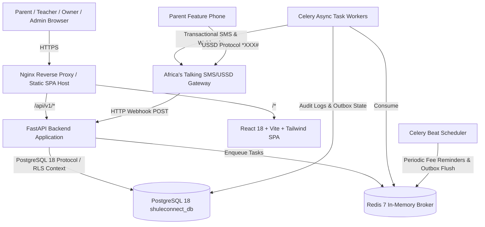

# ShuleConnect (Tanzania)
> **Production-Oriented Education Communication & Parent Engagement SaaS**
> Built for private primary and secondary schools in Tanzania.

[](https://github.com/shuleconnect/shuleconnect/actions/workflows/ci.yml)
[](LICENSE)
[](https://www.postgresql.org/)
[](https://www.python.org/)
[](https://fastapi.tiangolo.com/)
[](https://react.dev/)

---

## 1. Executive Summary & Purpose

**ShuleConnect** is an enterprise-grade, multi-tenant communication and parent-engagement platform engineered specifically for Tanzanian educational workflows. Rather than attempting to bloat into a cumbersome ERP, ShuleConnect focuses relentlessly on the high-friction communication bridge between schools, class teachers, and parents/guardians.

### Key Capabilities
- **Multi-Tenant PostgreSQL 18 with Native Row-Level Security (RLS)**: Enforces complete physical/logical tenant isolation at the database kernel level across 79 tables using session variables (`app.current_school_id`).
- **Unified Excel Import Center**: Enterprise spreadsheet ingestion engine supporting 4 mission-critical workflows:
  1. Student Registration & Annual Enrollment (with USSD Access ID assignment)
  2. Multi-Subject Examination Matrix Results
  3. Fee Structures & Due Dates
  4. Student Fee Balances & Opening Accounts
  Features strict formula injection sanitization (`=`, `+`, `-`, `@`), duplicate file hash detection, structured preview, dry-run validation, atomic commit, and granular rollback.
- **NECTA National Assessment Module**:
  - Ingests official Form Two National Assessment (**FTNA**) and Certificate of Secondary Education Examination (**CSEE**) results from NECTA portal/Maktaba HTML tables.
  - Multi-tier candidate matching engine: Exact examination index number matching (`S0101/0001`) with fallback to candidate name similarity scoring.
  - Match confirmation and review workflow with SMS dispatch to parents.
- **Class-Centric Operational Model**: Empowers Class Teachers as operational administrators of their specific classes with strict cross-class data boundary isolation.
- **Tanzanian Communication Rail & Hardened USSD**:
  - Direct integration with **Africa's Talking** Bulk SMS and USSD gateways.
  - Strict E.164 normalization for Tanzanian mobile networks (Vodacom, Airtel, Tigo, Halotel, TTCL: `+255...`).
  - Automatic GSM 7-bit vs Unicode detection and multi-part SMS concatenation.
  - **Deterministic Multi-School USSD Routing**: Parents with children across different schools seamlessly select their institution upon dialing `*384*55#`.
  - **Cryptographic 6-Digit OTP Verification**: 5-minute TTL, SHA-256 salted digest, and 3-attempt brute-force prevention before revealing sensitive examination marks or fee balances.
- **Financial Ledger & Automated Reconciliation**:
  - Fee schedule creation, student invoice generation, and idempotent multi-invoice payment allocation.
  - Automated reconciliation engine identifying discrepancies between invoice payment ledgers and external imported snapshots.
  - Authorized audit-tracked adjustments (Waivers, Discounts, Corrections).
- **Tanzania PDPA 2022 Compliance**: Personal Data Protection Act compliance where sensitive examination marks are never broadcast over unencrypted, insecure bulk SMS. Instead, parents receive a cryptographically signed notification link or OTP-verified USSD prompt.
- **Modular Academic Hierarchy**: Configurable academic structures supporting both Primary Schools (Standard 1 to 7) and Secondary Schools (Form 1 to 6 / A-Level), streams (A, B, C), and terms.

---

## 2. Architecture & Technology Stack



### Technology Matrix

| Layer | Technologies |
| :--- | :--- |
| **Frontend** | React 18, TypeScript, Vite, Tailwind CSS, TanStack Query, React Hook Form, Zod, React Router, Lucide Icons |
| **Backend** | Python 3.12, FastAPI, SQLAlchemy 2.0 (Mapped Column Syntax), Psycopg 3, Alembic, PyJWT, Argon2id (`argon2-cffi`) |
| **Database** | PostgreSQL 18 with Native Row-Level Security (RLS), UUIDv4 PKs, Foreign Keys, JSONB metadata, Partial B-Tree Indexes |
| **Workers & Cache**| Redis 7, Celery 5.4, Celery Beat, Transactional Outbox Pattern |
| **Integrations** | Africa's Talking SMS API v2, Africa's Talking USSD Gateway, Tanzania E.164 Engine |
| **DevOps & CI** | Docker, Docker Compose, Nginx, GitHub Actions, Systemd integration |

---

## 3. Directory Structure

```
shuleconnect/
├── backend/
│   ├── alembic/                # Database migrations (Alembic)
│   ├── app/
│   │   ├── api/v1/             # REST endpoints (auth, schools, academic, students, etc.)
│   │   ├── core/               # Database engine, config, security, seed data
│   │   ├── integrations/       # Africa's Talking provider adapter
│   │   ├── models/             # SQLAlchemy 2.0 models (67 tables across 8 domains)
│   │   ├── schemas/            # Pydantic validation schemas
│   │   ├── utils/              # Tanzanian phone validation, SMS segmentation
│   │   └── workers/            # Celery application, campaign tasks, fee schedulers
│   ├── tests/                  # Pytest integration, unit, and security test suites
│   ├── Dockerfile
│   └── requirements.txt
├── frontend/
│   ├── src/
│   │   ├── components/         # Shared UI components (Layout, Language Switcher)
│   │   ├── features/           # Workspaces: Auth, Owner, Teacher, Parent, Admin
│   │   ├── services/           # Axios API client & typed endpoints
│   │   ├── types/              # TypeScript interface definitions
│   │   ├── App.tsx             # Route declarations
│   │   └── main.tsx            # Application entrypoint
│   ├── Dockerfile
│   ├── nginx.conf
│   └── package.json
├── docs/                       # Architecture, database schema, security policy
├── scripts/                    # Maintenance & verification utilities
├── docker-compose.yml          # Containerized orchestration
├── Makefile                    # Developer automation targets
└── README.md
```

---

## 4. Local Development Setup

### Prerequisites
- **OS**: Linux (Fedora 40+, Ubuntu 22.04+, or macOS/WSL2)
- **PostgreSQL 18**: Active on `127.0.0.1:5432` with user `shuleconnect_user` and database `shuleconnect_db`
- **Redis**: Active on `127.0.0.1:6379`
- **Python**: 3.12+
- **Node.js**: 20+ & `pnpm` (10+)

### 1. Backend Setup
```bash
cd backend
python3.12 -m venv venv
source venv/bin/activate
pip install --upgrade pip
pip install -r requirements.txt

# Copy environment variables
cp ../.env.example ../.env

# Apply database migrations & seed initial permissions and superadmin
alembic upgrade head
python -m app.core.seed
```

### 2. Frontend Setup
```bash
cd ../frontend
pnpm install
pnpm build # Verify production bundle
```

### 3. Running Development Servers
You can run services concurrently using the root `Makefile`:
```bash
# Terminal 1: Backend API
make dev-backend

# Terminal 2: Celery Worker
make dev-worker

# Terminal 3: Celery Beat (Periodic jobs)
make dev-beat

# Terminal 4: Frontend Development Server
make dev-frontend
```

The application will be accessible at:
- **Frontend UI**: [http://localhost:5173](http://localhost:5173)
- **Backend API & Swagger Docs**: [http://localhost:8000/docs](http://localhost:8000/docs)
- **API Redoc**: [http://localhost:8000/redoc](http://localhost:8000/redoc)

---

## 5. Testing & Quality Assurance

The test suite exercises cross-tenant RLS boundaries, authentication integrity, Tanzanian phone normalization, GSM-7/Unicode SMS segmentation, grading standards, Excel import workflows, NECTA parsing and candidate auto-matching, secure USSD OTP state machine, and financial reconciliation:

```bash
# Run all tests
make test

# Run individual test suites
make test-unit
make test-integration
make test-security
```

Sample output:
```
tests/integration/test_api_workflows.py::test_full_school_lifecycle_and_features PASSED
tests/integration/test_fees_and_reconciliation.py::test_fee_reconciliation_workflow PASSED
tests/integration/test_ussd_otp_and_flow.py::test_ussd_unregistered_phone PASSED
tests/integration/test_ussd_otp_and_flow.py::test_ussd_otp_generation_and_verification PASSED
tests/integration/test_ussd_otp_and_flow.py::test_ussd_multi_school_routing PASSED
tests/security/test_security_isolation.py::test_cross_tenant_isolation PASSED
tests/security/test_security_isolation.py::test_unauthenticated_request_rejected PASSED
tests/unit/test_excel_imports.py::test_formula_injection_sanitization PASSED
tests/unit/test_excel_imports.py::test_parse_csv_file_valid PASSED
tests/unit/test_excel_imports.py::test_parse_csv_empty_file PASSED
tests/unit/test_excel_imports.py::test_student_import_workflow_validation PASSED
tests/unit/test_grading_and_fees.py::test_calculate_grade_standards PASSED
tests/unit/test_grading_and_fees.py::test_calculate_grade_different_max_score PASSED
tests/unit/test_necta_service.py::test_parse_candidate_row_pipe_format PASSED
tests/unit/test_necta_service.py::test_parse_candidate_row_regex_fallback PASSED
tests/unit/test_necta_service.py::test_parse_candidate_row_invalid PASSED
tests/unit/test_necta_service.py::test_necta_matcher_exact_and_review PASSED
tests/unit/test_phone_and_sms.py::test_tanzanian_phone_normalization_valid PASSED
tests/unit/test_phone_and_sms.py::test_tanzanian_phone_normalization_invalid PASSED
tests/unit/test_sms_segmentation_gsm7 PASSED
tests/unit/test_sms_segmentation_unicode PASSED
============================== 21 passed in 3.78s ==============================
```

---

## 6. Default Credentials & Role Matrix

After running `python -m app.core.seed`, the following default platform administrator is initialized:

| Role | Email / Identifier | Password | Scope |
| :--- | :--- | :--- | :--- |
| **Platform Super Admin** | `admin@shuleconnect.co.tz` | `SuperAdmin2026!` | Global / All Tenants |
| **School Owner** | Configured during school registration | User-defined | School Wide |
| **Class Teacher** | Registered by Owner/Admin | User-defined | Assigned Class Scope |
| **Parent/Guardian** | Verified Tanzanian Mobile (`+255...`) | One-Time SMS Code | Linked Children Scope |

---

## 7. Tanzanian Regulatory & Localization Compliance

1. **Personal Data Protection Act (PDPA 2022)**:
   - Student academic rankings and marks are classified as sensitive student data.
   - Examination notifications deliver private tokenized links requiring phone verification, preventing accidental disclosure of academic records over plain-text SMS.
2. **Telecommunications Regulatory Authority (TCRA) SMS Compliance**:
   - Registered Sender ID support (`SHULECONN` or custom approved school alphanumeric sender IDs).
   - Opt-out mechanics and automated SMS deduplication to prevent spamming parents with multiple children in the same school.
3. **Curriculum & Grading Models**:
   - Supports National Examinations Council of Tanzania (**NECTA**) grading scales (A: 75-100, B: 65-74, C: 45-64, D: 30-44, F: 0-29) as well as custom private school grading schemes.

---

## 8. License & Commercial Rights
Copyright © 2026 ShuleConnect Technologies Ltd. All Rights Reserved.
Unauthorized copying or distribution of this software is strictly prohibited.
