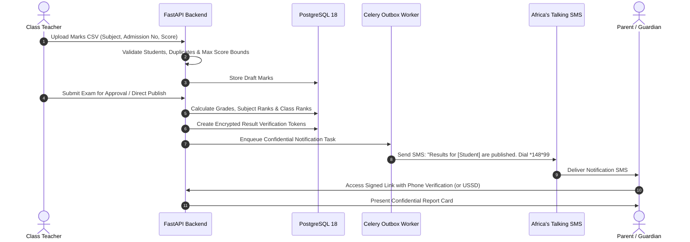

# ShuleConnect Architecture Overview

## 1. System Philosophy & Objectives

ShuleConnect is engineered as a **modular monolith** with independently scalable background asynchronous workers. It bridges communication gaps in Tanzanian private schools while avoiding the bloated complexity of massive traditional legacy ERPs.

The architecture addresses four hard operational realities of Tanzanian educational institutions:
1. **Heterogeneous Device Connectivity**: While school administrators and teachers utilize desktop and modern smartphones, a significant portion of parents rely on standard feature phones (2G/3G) or intermittent mobile data connections. Hence, communication channels must seamlessly span Web SPA, Bulk SMS, and USSD (`*148*...#`).
2. **Multi-Tenant Data Privacy & Regulatory Compliance**: Tanzanian schools operate in a competitive private educational market. Leaking student lists, parent contact directories, or fee structures across competing schools is a catastrophic violation. Native PostgreSQL Row-Level Security (RLS) is used to guarantee isolation at the database kernel level.
3. **Class-Scoped Operational Boundaries**: Class teachers are the primary frontline operators. They know their students and parents intimately. The system delegates operational power directly to class teachers while preventing unauthorized lateral access into unassigned classrooms.
4. **Resilient Asynchronous Messaging**: Sending bulk communications to hundreds or thousands of parents during report card release or fee reminder drives must never block HTTP API request cycles or risk dropped messages. The platform uses Redis, Celery, and a transactional outbox pattern to guarantee at-least-once delivery.

---

## 2. Component Topology

```mermaid
flowchart TD
    subgraph Clients["Client Layer"]
        Browser["Desktop & Mobile Web Browsers<br/>(React 18 / Vite / Tailwind)"]
        FeaturePhone["Parent Feature Phone<br/>(SMS / USSD Protocol)"]
    end

    subgraph Ingress["Ingress & Gateway"]
        Nginx["Nginx Reverse Proxy / SSL Termination<br/>(Static Assets + /api/ Proxy)"]
        ATGateway["Africa's Talking Gateway<br/>(SMS API, Delivery Callbacks, USSD Webhook)"]
    end

    subgraph AppLayer["Application Layer"]
        FastAPI["FastAPI Core API Engine<br/>(Python 3.12 / Pydantic / SQLAlchemy 2.0)"]
        USSDHandler["USSD Deterministic State Engine<br/>(/api/v1/ussd/session)"]
        WebhookHandler["Delivery Report Webhook Engine<br/>(/api/v1/webhooks/delivery-reports)"]
    end

    subgraph DataLayer["Storage & Cache Layer"]
        Postgres[(PostgreSQL 18 Multi-Tenant Engine<br/>Native RLS / 67 Tables / UUIDv4)]
        Redis[(Redis 7 In-Memory Store<br/>Celery Queue & USSD Session Cache)]
    end

    subgraph WorkerLayer["Asynchronous Worker Layer"]
        OutboxWorker["Transactional Outbox Worker<br/>(celery-worker)"]
        CampaignWorker["Bulk Campaign Dispatch Worker<br/>(celery-worker)"]
        FeeScheduler["Automated Daily Fee Scheduler<br/>(celery-beat)"]
    end

    Browser -->|HTTPS| Nginx
    Nginx -->|/api/v1/*| FastAPI
    FeaturePhone <-->|USSD Session| ATGateway
    FeaturePhone <--|GSM SMS| ATGateway
    ATGateway <-->|USSD Webhook POST| USSDHandler
    ATGateway -->|DLR Webhook POST| WebhookHandler
    
    FastAPI -->|Set Context & Query| Postgres
    FastAPI -->|Enqueue Tasks| Redis
    USSDHandler <-->|Session State| Redis
    USSDHandler -->|Read Grades & Balances| Postgres

    Redis --> OutboxWorker
    Redis --> CampaignWorker
    Redis --> FeeScheduler

    OutboxWorker -->|HTTP POST| ATGateway
    CampaignWorker -->|HTTP POST| ATGateway
    OutboxWorker -->|Update Status| Postgres
    CampaignWorker -->|Batch Results| Postgres
    FeeScheduler -->|Create Invoices & Reminders| Postgres
```

---

## 3. Database Architecture & Multi-Tenancy

### 3.1 PostgreSQL 18 Native Row-Level Security (RLS)
Unlike conventional multi-tenant architectures that rely solely on application-level filtering (`WHERE school_id = ...`)—which are vulnerable to developer oversight or SQL injection—ShuleConnect enforces tenant boundaries at the database engine level.

1. **Tenant Context Binding**:
   When an authenticated request enters FastAPI, the user's JWT is decoded and their `school_id` is extracted. In the database session dependency:
   ```python
   # Parameterized execution prevents injection into PostgreSQL settings
   db.execute(text("SELECT set_config('app.current_school_id', :val, true)"), {"val": str(school_id)})
   ```
2. **Deterministic Table Policies**:
   Every tenant-scoped table (such as `classes`, `students`, `guardians`, `campaigns`, `invoices`) has RLS enabled with a policy:
   ```sql
   CREATE POLICY tenant_isolation_policy ON students
       FOR ALL
       USING (
           school_id = NULLIF(current_setting('app.current_school_id', true), '')::uuid
           OR current_setting('app.is_super_admin', true) = 'true'
       );
   ```
3. **Platform Super Admin Bypass**:
   System-wide operations (such as school compliance audits and billing reviews) safely set `app.is_super_admin = 'true'`, granting legitimate global visibility while keeping individual school sessions strictly confined.

---

## 4. Communication Pipeline & Optimization

### 4.1 Tanzanian E.164 Phone Normalization
Phone numbers entered by parents and school staff come in various formats (`0754123456`, `+255754123456`, `255 754 123 456`, `754123456`).
The normalization utility (`backend/app/utils/phone.py`):
- Strips all non-digit formatting characters.
- Detects the leading `0` or country code prefix.
- Validates the network operator code against valid Tanzanian telco ranges:
  - Vodacom: `074`, `075`, `076`
  - Airtel: `068`, `069`, `078`, `079`
  - Tigo: `065`, `067`, `071`
  - Halotel: `061`, `062`
  - TTCL: `073`
- Normalizes strictly to `+255XXXXXXXXX`. Invalid numbers are flagged before expensive gateway dispatch.

### 4.2 GSM 7-bit vs Unicode SMS Segmentation
To minimize SMS costs for schools, the system analyzes every message body:
- **GSM 7-bit Encoding**: If the text contains only standard 7-bit characters, single messages allow up to 160 characters; concatenated messages allow 153 characters per segment.
- **Unicode Encoding (UCS-2)**: If special symbols or non-standard characters are detected, single messages allow up to 70 characters; concatenated messages allow 67 characters per segment.
- The UI provides real-time character counting, segment calculation, and estimated Tanzanian Shillings (TZS) cost before dispatch.

### 4.3 Template Engine & Deduplication
- Messages support dynamic variable interpolation: `{{parent_name}}`, `{{student_name}}`, `{{class_name}}`, `{{school_name}}`, `{{exam_name}}`, `{{fee_balance}}`, `{{due_date}}`.
- When broadcasting to parents who have multiple children enrolled in the same class, the system deduplicates by guardian mobile number to prevent billing the school for redundant SMS notifications.

---

## 5. Examination Results Workflow & PDPA Compliance

Under the Tanzanian **Personal Data Protection Act (PDPA 2022)**, exposing academic scores publicly or transmitting child performance metrics over insecure plain-text channels is non-compliant.



---

## 6. Financial Ledger & Automated Reminder Mechanics

1. **Double-Entry Style Allocations**:
   - `fee_structures`: Defines standard fee items (Tuition, Transport, Meals, Examination) per class and term.
   - `student_invoices`: Concrete billables assigned to students.
   - `fee_payments`: External incoming money events (e.g., Bank Slip, M-Pesa, Airtel Money, Cash).
   - `fee_payment_allocations`: Immutable ledger rows linking a payment to one or more invoices.
2. **Automated Reminders**:
   - Celery Beat triggers a daily morning task (`check_pending_fee_reminders`).
   - Identifies active invoices where `balance_due_tzs > 0` and `due_date <= TODAY + threshold`.
   - Checks frequency limits (e.g., maximum 1 reminder every 7 days) to avoid harassment.
   - Creates queued outbound campaign messages using personalized templates.

---

## 7. Interactive USSD Engine

Feature phone users can dial the school's USSD shortcode (`*148*...#`) to receive real-time updates:

```
[Main Menu]
Karibu ShuleConnect!
1. Matokeo ya Mtihani (Exam Results)
2. Salio la Ada (Fee Balance)
3. Matangazo na Mikutano (Notices & Meetings)
4. Badili Lugha / Change Language
```

- **Session Handling**: Multi-turn sessions are stored in Redis with a 120-second TTL.
- **Identity Verification**: The incoming caller's MSISDN (`+255...`) is matched against verified guardian records in the database.
- **Dual Language**: Seamless instant toggle between English and Kiswahili.
