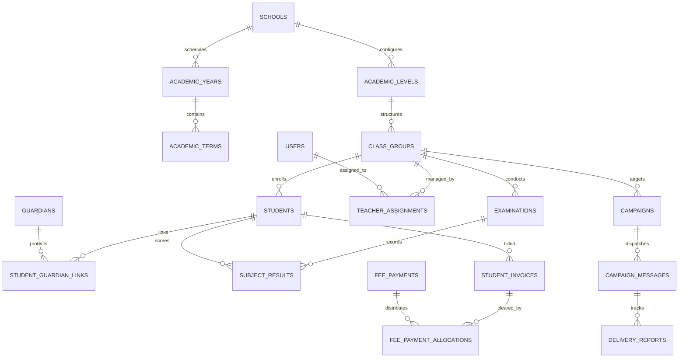

# ShuleConnect Database Schema & Entity Documentation

## 1. Schema Design Principles
The ShuleConnect database runs on **PostgreSQL 18** and is designed with strict data integrity, multi-tenancy, and compliance guarantees:
- **Identifier Strategy**: All primary keys are `UUIDv4` generated via `uuid7` or standard cryptographic random identifiers to prevent ID enumeration attacks across schools.
- **Auditing & Timestamps**: Every table inherits from `TimestampMixin` with timezone-aware `created_at` and `updated_at` columns (`TIMESTAMP WITH TIME ZONE`).
- **Tenant Isolation**: Tables containing institutional data enforce foreign key relationships to `schools(id)` with cascading rules, combined with PostgreSQL 18 Row-Level Security (RLS) policies.
- **Precision Currency**: All monetary figures (`amount_tzs`, `balance_due_tzs`) use `NUMERIC(14, 2)` to eliminate floating-point rounding errors in Tanzanian Shillings.

---

## 2. Entity Relationship Overview



---

## 3. Core Tables Reference

### 3.1 Identity & Access Domain

#### `users`
Represents institutional staff, owners, administrators, and teachers.
| Column | Type | Constraints | Description |
| :--- | :--- | :--- | :--- |
| `id` | UUID | PK, DEFAULT uuid_generate_v4() | Unique user identifier |
| `school_id` | UUID | FK(schools.id), NULLABLE | Associated school (null for platform superadmins) |
| `email` | VARCHAR(255) | UNIQUE, INDEX | Primary login email |
| `hashed_password` | VARCHAR(255) | NOT NULL | Argon2id cryptographically salted hash |
| `full_name` | VARCHAR(255) | NOT NULL | Full personal name |
| `phone_number` | VARCHAR(32) | NOT NULL, INDEX | Normalized E.164 phone number (`+255...`) |
| `is_active` | BOOLEAN | DEFAULT TRUE | Account state |
| `is_super_admin` | BOOLEAN | DEFAULT FALSE | Global platform oversight flag |
| `created_at` | TIMESTAMPTZ | NOT NULL | Record creation timestamp |
| `updated_at` | TIMESTAMPTZ | NOT NULL | Last update timestamp |

#### `roles` & `permissions`
Implements granular Role-Based Access Control (RBAC). Default roles include `SUPER_ADMIN`, `SCHOOL_OWNER`, `SCHOOL_ADMIN`, `CLASS_TEACHER`, and `PARENT`.

---

### 3.2 Academic Structure Domain

#### `schools`
Central institution record.
| Column | Type | Description |
| :--- | :--- | :--- |
| `id` | UUID | PK |
| `name` | VARCHAR(255) | Official registered name of the school |
| `registration_number` | VARCHAR(100) | Ministry of Education (MoEST) registration number |
| `school_type` | VARCHAR(50) | `PRIMARY` or `SECONDARY` |
| `region` | VARCHAR(100) | Tanzanian region (e.g. Dar es Salaam, Arusha, Mwanza) |
| `district` | VARCHAR(100) | Administrative district |
| `postal_address` | VARCHAR(255) | Postal address |
| `contact_email` | VARCHAR(255) | School communications email |
| `contact_phone` | VARCHAR(32) | School primary phone |
| `sms_sender_id` | VARCHAR(11) | Registered TCRA SMS Sender ID (e.g. `SHULECONN`) |
| `is_verified` | BOOLEAN | Super Admin verification status |

#### `class_groups`
Concrete classroom units (e.g., "Standard 1A", "Form 2B").
| Column | Type | Description |
| :--- | :--- | :--- |
| `id` | UUID | PK |
| `school_id` | UUID | FK(schools.id) |
| `academic_level_id` | UUID | FK(academic_levels.id) |
| `stream_id` | UUID | FK(streams.id), NULLABLE |
| `name` | VARCHAR(100) | Name of the class group (e.g., `Standard 4A`) |
| `max_capacity` | INTEGER | Maximum enrolled students capacity |
| `is_active` | BOOLEAN | Active status |

#### `students`
Student profile records.
| Column | Type | Description |
| :--- | :--- | :--- |
| `id` | UUID | PK |
| `school_id` | UUID | FK(schools.id) |
| `admission_number` | VARCHAR(100) | Institutional student roll / admission number |
| `full_name` | VARCHAR(255) | Official full name |
| `gender` | VARCHAR(10) | `M` or `F` |
| `date_of_birth` | DATE | Date of birth |
| `current_class_group_id` | UUID | FK(class_groups.id) |
| `is_active` | BOOLEAN | Active enrollment status |

#### `guardians` & `student_guardian_links`
Parent and legal guardian contact profiles.
- `guardians`: Stores full name, normalized phone number (`+255...`), email, preferred language (`sw` for Kiswahili, `en` for English), and verification status.
- `student_guardian_links`: Associative table supporting many-to-many relationships (multiple guardians per student, multiple siblings per guardian) with relationship types (`FATHER`, `MOTHER`, `GUARDIAN`) and emergency contact flags.

---

### 3.3 Communication Domain

#### `communication_campaigns` & `campaign_recipients`
- `communication_campaigns`: Group dispatch records containing message templates, targeting modes (`CLASS_BULK`, `SELECTED_STUDENTS`, `INDIVIDUAL`), sender user, total recipient count, and estimated SMS cost in TZS.
- `campaign_recipients`: Individual SMS delivery records tracking the interpolated text, destination phone number, segment count, Africa's Talking message ID, and delivery status (`QUEUED`, `SENT`, `DELIVERED`, `FAILED`).
- `message_delivery_events`: Stores immutable delivery receipt events received via Africa's Talking webhook callbacks for delivery rate analytics.

---

### 3.4 Examination & Grading Domain

#### `examinations`
Represents an academic assessment (e.g. "Term 1 Midterm 2026", "Form 4 Mock Exam").
- Configurable maximum score (`max_score`, default 100).
- Publication status: `DRAFT`, `SUBMITTED_FOR_APPROVAL`, `APPROVED`, `PUBLISHED`.
- Configurable grading standards with dynamic cutoff intervals.

#### `student_exam_results`
Individual student subject mark records.
- Stores raw score (`score`), converted letter grade (`A`, `B`, `C`, `D`, `F`), calculated grade points, rank in subject, and teacher's qualitative remarks.

---

### 3.5 Fees & Financial Ledger Domain

#### `fee_structures` & `fee_categories`
Defines institutional fee templates per academic level and term (e.g. Tuition: 400,000 TZS, Meal Plan: 150,000 TZS, Transport: 200,000 TZS).

#### `fee_invoices`
Concrete billing statements assigned to students.
- `amount_tzs`: Total invoice amount.
- `paid_amount_tzs`: Cumulative amount paid to date.
- `balance_due_tzs`: Remaining outstanding balance.
- `due_date`: Payment deadline date.
- `status`: `UNPAID`, `PARTIAL`, `PAID`, `OVERDUE`.

#### `fee_payments` & `fee_payment_allocations`
Records inbound bank slips, mobile money transactions (M-Pesa, Airtel Money, Tigo Pesa), and cash receipts, idempotently allocating them across one or more outstanding invoices.

---

## 4. Row-Level Security (RLS) Configuration

PostgreSQL Row-Level Security policies are applied across all 31 tenant tables:

```sql
-- Pattern applied to each tenant table
ALTER TABLE <table> ENABLE ROW LEVEL SECURITY;
ALTER TABLE <table> FORCE ROW LEVEL SECURITY;

CREATE POLICY tenant_isolation_policy ON <table>
    FOR ALL
    USING (
        school_id = NULLIF(current_setting('app.current_school_id', true), '')::uuid
        OR current_setting('app.is_super_admin', true) = 'true'
    )
    WITH CHECK (
        school_id = NULLIF(current_setting('app.current_school_id', true), '')::uuid
        OR current_setting('app.is_super_admin', true) = 'true'
    );
```

---

## 5. Enhanced Enterprise Modules

### 5.1 Excel Import Center (`import_*`)
The import engine provides staging, dry-run validation, and rollback across 5 relational tables:
- `import_batches`: Tracks workflow type (`STUDENT_REGISTRATION`, `EXAM_RESULTS`, `FEE_STRUCTURES`, `FEE_BALANCES`), status (`UPLOADED` -> `COMMITTED`), row metrics (`total_rows`, `new_records_count`, `rejected_records_count`), and reversion timestamps.
- `import_batch_files`: Uploaded spreadsheet metadata, SHA-256 hash deduplication, MIME type, and storage reference.
- `import_staging_rows`: Staged raw and mapped JSON rows before commit, tracking individual row statuses (`PENDING`, `VALID`, `ERROR`, `COMMITTED`).
- `import_validation_errors`: Granular row and column-level error descriptions (e.g., formula injection, invalid phone, missing admission, out-of-bounds score).
- `import_change_records`: Audit journal recording before/after JSON states of all created or updated entities for atomic rollback.

### 5.2 NECTA National Assessment Module (`necta_*`)
- `necta_examinations`: Exam registry for FTNA/CSEE national examinations by year, exam type, center number, and center name.
- `necta_candidates`: Candidate index numbers, sex, division (I, II, III, IV, 0), and aggregate points.
- `necta_candidate_subjects`: Individual subject letter grades (e.g., CIV - 'C', KISW - 'A', B/MATH - 'B').
- `necta_student_matches`: Student link associations with confidence score (1.0 for exact index match, 0.9 for candidate name match) and review status (`MATCHED`, `PENDING_REVIEW`, `REJECTED`).
- `necta_fetch_errors`: Downstream crawling/parsing error journal.

### 5.3 USSD OTP & Security Verification (`ussd_otp_verifications`)
- `ussd_otp_verifications`: Tracks 6-digit cryptographic OTP challenges, SHA-256 salted hashes, 5-minute TTL, attempt counters (max 3), and verified handset sessions to safeguard student examination results and fee balances.
- `guardian_contact_history`: Immutable log of guardian phone changes, recording initiating user ID, old phone, new phone, change reason, and invalidation of prior USSD sessions.
